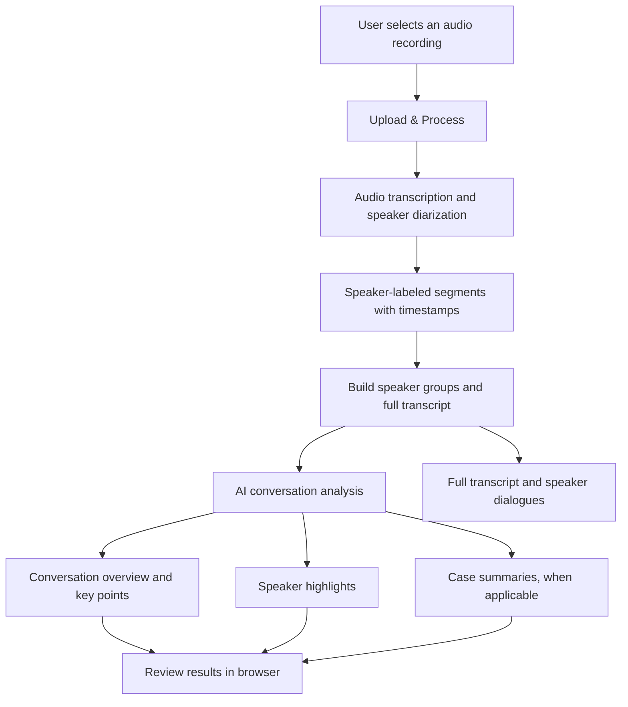

# Speaker Analysis

**AI-powered audio transcription, speaker identification, and conversation intelligence**

Speaker Analysis turns a recorded conversation into a readable, speaker-separated transcript and an AI-generated explanation of what was discussed. It is particularly useful for reviewing law-firm conversations and case discussions, but the analysis also supports interviews, meetings, podcasts, educational sessions, insurance discussions, and other multi-person recordings.

Rather than producing only a block of transcript text, the application helps answer **who said what, what the conversation was about, what mattered, and what conclusions were reached**.

## Main features

### 1. Audio upload and processing

Select an audio recording from the browser and choose **Upload & Process**. The application submits the recording for transcription, then automatically analyzes the resulting transcript. The interface displays a **Processing...** state while the request is underway and shows an error if a stage fails.

- Browser audio-file selector (`audio/*`)
- Audio upload limit of **25 MB**, enforced by the server's multipart parser
- One-step user workflow: upload → transcription → analysis → results
- Each new processing run clears the previous results before starting

### 2. Speaker identification (diarization)

The transcription service identifies speaker turns and labels them, such as **Speaker A** and **Speaker B**. Each speech segment includes its text and, where available, its start and end times.

The application groups all segments belonging to each speaker, making it easy to read one person's contributions without searching through the entire recording.

**Example of speaker-separated dialogue (illustrative):**

> **Speaker A** · 00:12–00:18  
> Could you explain the background of this case?
>
> **Speaker B** · 00:19–00:31  
> The dispute began after the contract terms were changed.

Speaker labels identify different voices; they do **not** verify the real-world identities of the people speaking.

### 3. Full speaker-labeled transcript

In addition to individual speaker sections, the application assembles a single transcript with speaker labels in conversational order. The complete transcript is available in an expandable **Show full diarized transcript text** section, so users can inspect the original dialogue behind the AI summary.

### 4. Conversation classification and context

The AI interprets the content and classifies the conversation as one of the following broad types:

| Type | Typical conversation |
| --- | --- |
| Legal | Lawyer-client discussions, legal matters, case reviews |
| Educational | Lessons, lectures, explanations |
| Podcast | Host-and-guest discussions |
| Interview | Questions and answers between interviewer and participant |
| Meeting | Team discussions and business meetings |
| General | Other recorded conversations |

The classification is generated from the transcript; it is not selected manually by the user.

### 5. Conversation overview and summary

The **Conversation Analysis** section presents:

- **Title:** a short descriptive title generated from the recording
- **Conversation type:** the inferred category
- **Main topic:** the central subject of the discussion
- **Overall summary:** a narrative explanation of the conversation
- **Key points:** important facts, arguments, questions, or ideas
- **Final context / verdict:** the closing takeaway, recommendation, or outcome expressed in the discussion

This gives readers a high-level understanding before they review the complete transcript.

### 6. Individual speaker highlights

For each speaker, the AI attempts to describe their role in the conversation and summarize their main contributions. Roles may include **host, guest, lawyer, narrator, participant, or unknown**.

Speaker highlights help distinguish, for example, the person asking questions from the person providing explanations. These roles are AI inferences and should be checked against the recording when accuracy matters.

### 7. Legal case detection and separate case summaries

When the transcript contains legal case discussions, the application attempts to identify **each case separately** rather than blending multiple matters into one summary.

For each detected case, the interface can display:

| Field | What it communicates |
| --- | --- |
| Case title | A short label for the matter discussed |
| Case summary | The situation, issues, and discussion surrounding the case |
| Emphasis points | Important facts, arguments, or considerations |
| Final verdict | An outcome, conclusion, or recommendation **if discussed** |
| Speakers involved | Which labeled speakers participated in that case discussion |
| Notable numbers | Dates, monetary amounts, durations, and other quantities with context |

**Important:** “Final verdict” is a field name in the AI output. It does not mean the system has verified a court ruling. The result reflects what the transcript says. If no legal cases are identified, the case-summary section is omitted while the general conversation analysis remains available.

### 8. Results organized for review

The web interface separates the output into three primary areas:

1. **Conversation Analysis** — title, category, topic, summary, key points, final takeaway, and speaker highlights.
2. **Detected Case Summaries** — individual legal matters and their supporting details, when applicable.
3. **Speakers & Dialogues** — a card for each speaker, with their timestamped speech segments and an expandable full transcript.

This layout supports both quick executive review and detailed examination of who said what.

## How the application works



The transcription stage uses **OpenAI `gpt-4o-transcribe-diarize`** with automatic chunking and diarized JSON output. The analysis stage uses **OpenAI `gpt-4o`** to interpret the speaker-labeled transcript and produce structured conversation information. The application is built with **Next.js and React**.

## Example use cases

**Law firms and legal teams:** Review recorded discussions, identify individual cases, examine each speaker's statements, and surface dates, amounts, and case-specific conclusions.

**Business meetings:** Produce a summary of discussion topics, key points, participant contributions, and closing takeaways.

**Interviews:** Separate interviewer and interviewee contributions and summarize the key themes of the exchange.

**Podcasts:** Identify speaker turns, capture episode themes, and summarize the main ideas shared by hosts and guests.

**Educational conversations:** Summarize explanations, examples, learning points, and each participant's contribution.

**Insurance discussions:** Capture the conversation's context, key facts, important numbers, and final discussion outcome.

## Current scope and important distinctions

The following distinctions describe the functionality implemented in the supplied code:

| Implemented | Not implemented in the supplied project |
| --- | --- |
| Upload an audio recording for analysis | Live microphone recording or real-time streaming |
| Speaker-separated transcription with timestamps | Verification of speakers' actual identities |
| AI-generated summary, key points, and speaker highlights | Searchable history or persistent recording library |
| Legal case extraction when cases are discussed | External court-record verification or legal advice |
| Browser-based review of the full transcript | Built-in transcript editing or downloadable PDF/DOCX reports |
| Processing and error states | User accounts, team permissions, or collaboration |

**Accuracy note:** Transcription, speaker separation, role attribution, and generated summaries can contain errors. Audio quality, overlapping voices, technical vocabulary, and ambiguous statements may affect results. For legal or other high-stakes use, review the recording and transcript before relying on the generated analysis.

## License

MIT License. See [LICENSE](LICENSE).

---

**Speaker Analysis** · Deligence TechnologiesThis is a [Next.js](https://nextjs.org) project bootstrapped with [`create-next-app`](https://nextjs.org/docs/pages/api-reference/create-next-app).

## Getting Started

First, run the development server:

```bash
npm run dev
# or
yarn dev
# or
pnpm dev
# or
bun dev
```

Open [http://localhost:3000](http://localhost:3000) with your browser to see the result.

You can start editing the page by modifying `pages/index.js`. The page auto-updates as you edit the file.

[API routes](https://nextjs.org/docs/pages/building-your-application/routing/api-routes) can be accessed on [http://localhost:3000/api/hello](http://localhost:3000/api/hello). This endpoint can be edited in `pages/api/hello.js`.

The `pages/api` directory is mapped to `/api/*`. Files in this directory are treated as [API routes](https://nextjs.org/docs/pages/building-your-application/routing/api-routes) instead of React pages.

This project uses [`next/font`](https://nextjs.org/docs/pages/building-your-application/optimizing/fonts) to automatically optimize and load [Geist](https://vercel.com/font), a new font family for Vercel.

## Learn More

To learn more about Next.js, take a look at the following resources:

- [Next.js Documentation](https://nextjs.org/docs) - learn about Next.js features and API.
- [Learn Next.js](https://nextjs.org/learn-pages-router) - an interactive Next.js tutorial.

You can check out [the Next.js GitHub repository](https://github.com/vercel/next.js) - your feedback and contributions are welcome!

## Deploy on Vercel

The easiest way to deploy your Next.js app is to use the [Vercel Platform](https://vercel.com/new?utm_medium=default-template&filter=next.js&utm_source=create-next-app&utm_campaign=create-next-app-readme) from the creators of Next.js.

Check out our [Next.js deployment documentation](https://nextjs.org/docs/pages/building-your-application/deploying) for more details.
